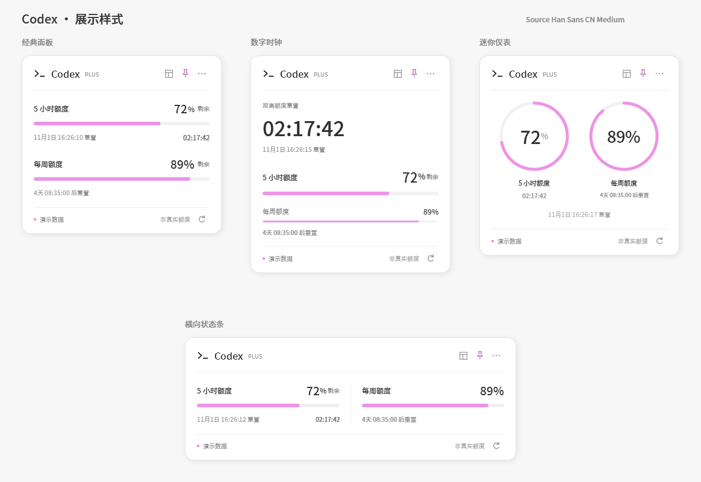

# Codex Quota Widget · Codex 额度小组件

[](https://github.com/xiaoheiHZ/codex-quota-widget/releases/latest)

A native Windows desktop widget for Codex usage limits, live reset countdowns and four animated layouts.

**[下载 Windows 版 ZIP](https://github.com/xiaoheiHZ/codex-quota-widget/releases/latest/download/CodexQuotaWidget-win-x64.zip)** · [版本记录](CHANGELOG.md) · [报告问题](https://github.com/xiaoheiHZ/codex-quota-widget/issues)

Windows 原生悬浮组件，白色面板，粉色 `#ED94E7`（ARGB `#FFED94E7`）额度条。采用 Codex 式紧凑排版、细分隔线与低对比辅助文字。1.1 版提供四种展示样式，并内置 Source Han Sans CN Medium 字体。



这是一个独立的社区项目，非 OpenAI 官方组件。

## 展示与动效

| 样式 | 展示方式 |
| --- | --- |
| 经典面板 | 纵向额度条与紧凑倒计时，延续原版布局 |
| 横向状态条 | 将两个额度窗口并排展示 |
| 数字时钟 | 突出显示重置倒计时，逐位滚动变化的数字 |
| 迷你仪表 | 用简洁的粉色环形进度展示额度，单窗口时自动居中 |

右上角布局按钮或 `Ctrl+Tab` 可循环切换；`··· → 展示样式` 可直接选取。样式、动效强度和精简模式会自动记忆。

“流畅”模式包含面板快照交叠、淡入滑动、尺寸与边缘位置过渡、逐位滚动数字、额度条扫光和悬停阴影。“轻柔”模式保留简短淡入与缓动，关闭扫光和数字滚动。“界面动效”可整体关闭，且尊重 Windows 的界面动画设置。逐帧回调只在数字变化期间运行，隐藏窗口时停止这些效果。

字体使用 [Adobe 官方的 SourceHanSansCN-Medium.otf](https://github.com/adobe-fonts/source-han-sans/blob/release/SubsetOTF/CN/SourceHanSansCN-Medium.otf)，以 500 字重嵌入 EXE，中文、英文、数字、倒计时与组件菜单均使用同一字体，无需安装系统字体。文件 SHA-256 为 `A94E558A2FE972BEE4F46BCE0843ABFF37063FD68C33F1E7D9058F6F09432B01`。原版字体未修改；[SIL OFL 1.1 许可](https://github.com/adobe-fonts/source-han-sans/blob/release/LICENSE.txt)附于 `SourceHanSans-LICENSE.txt`，也可在组件菜单的“字体许可”中查看。

## 使用

从 [Releases](https://github.com/xiaoheiHZ/codex-quota-widget/releases/latest) 下载 `CodexQuotaWidget-win-x64.zip` 并解压，双击其中的 `CodexQuotaWidget.exe` 即可运行，无需另装 .NET。需要 Windows 10/11 x64，并已安装、登录 Codex 桌面版或 Codex CLI。组件复用本机 Codex 的登录状态。

- 额度每 60 秒同步一次，倒计时每秒更新；F5 或右下角按钮立即刷新。
- 拖动面板移动位置，位置会自动保存。右上角图钉切换置顶。
- `···` 或右键打开设置，可切换精简模式、界面动效和开机启动。
- Esc 隐藏到托盘，双击托盘图标恢复。再次打开 EXE 也可恢复已运行的组件。
- 托盘右键或设置菜单中的“退出”彻底关闭组件。
- 开机启动默认关闭，由你在菜单中开启；启用后请保持 EXE 路径不变。

## 数据含义

百分比表示**剩余额度**，计算为 `100 - usedPercent`。窗口名称依据服务返回的窗口长度生成，不假定每个账号都有 5 小时和每周两个窗口。多个额度分组会显示选择框。

重置时间来自服务器 Unix 秒时间戳，按 Windows 本地时区显示。窗口到期后会显示“正在确认重置”，重新读取额度，不会自行补成 100%。断网时保留上次读数并明确标注；首次连接失败会显示错误提示，不填入演示数值。账号另有使用限制时会显示服务限制提示。

通过 Codex 的 `account/rateLimits/read` 读取真实额度。[官方接口说明](https://learn.chatgpt.com/docs/app-server)。该接口会随 Codex 版本变化；Codex 更新后若无法读取，可先重启组件与 Codex。

## 本地文件与隐私

组件启动一个无控制台窗口的 `codex app-server --listen stdio://` 子进程，只执行初始化和额度读取，不启动推理任务。组件不读取或复制 `auth.json`，不保存访问令牌、邮件、账号 ID 或对话，不监听网络端口。正常退出时关闭子进程。

位置和显示偏好保存在 `%LOCALAPPDATA%\CodexQuotaWidget\settings.json`。开机启动使用当前用户的 Windows Run 注册表项。删除组件前可先在菜单中关闭开机启动。

自动查找 Codex 安装目录与 PATH。如需指定版本，可设置环境变量 `CODEX_QUOTA_CODEX_PATH` 为 `codex.exe` 的完整路径。

## 构建与验证

源码使用 C# / WPF，目标 .NET 8 Windows。安装 .NET SDK（8 或以上）后执行 `./build.ps1`；打包 UI 检查需要 Python 3，无第三方 Python 依赖。生成的 EXE 自带 .NET 运行时。

```powershell
git clone https://github.com/xiaoheiHZ/codex-quota-widget.git
cd codex-quota-widget
./build.ps1
```

输出位于 `release/app/`，ZIP 位于 `release/`。额度解析、窗口渲染、动效和交互检查可在本地 Windows 会话中运行。

- `dotnet run --project tests/QuotaTests.csproj -c Release`：验证额度解析、缺失字段、多个分组、时间边界和倒计时。
- `python tools/check-ui.py`：验证 22 种真实渲染场景，覆盖四种样式、仅每周额度、已到期、零额度、未知重置时间、无动效、多分组和错误提示，检查字体解析、秒级计时与文本裁切；另检查 10 项动画行为，包括中途尺寸、快速切换、最终布局和关闭动画。
- `./tools/check-interactions.ps1 -WidgetProcessId <进程ID>`：对正在运行的经典面板检查 15 项交互，包括四种样式、样式子菜单、动效记忆、精简模式、置顶、托盘恢复和刷新。会暂时操作该组件并恢复为经典面板和流畅动效。
- `CodexQuotaWidget.exe --diagnose output.json`：只读检测真实额度，输出不含账号标识的解析结果。
- `CodexQuotaWidget.exe --demo`：明确标记的演示模式，不连接账号。
- `CodexQuotaWidget.exe --demo --style clock`：预览指定样式，样式 ID 为 `panel`、`strip`、`clock`、`orbit`。
- `CodexQuotaWidget.exe --demo --check-motion motion.json`：检查切换动画与减少动效行为，并输出一张切换中的画面。
- `CodexQuotaWidget.exe --capture preview.png`：读取真实额度、生成预览后退出。

## 第三方资源

Source Han Sans CN Medium 来自 Adobe 的 Source Han Sans 项目，遵循 SIL Open Font License 1.1。完整许可位于 [src/Assets/Fonts/LICENSE.txt](src/Assets/Fonts/LICENSE.txt)，并随发行包分发。参见 [THIRD_PARTY_NOTICES.md](THIRD_PARTY_NOTICES.md)。
